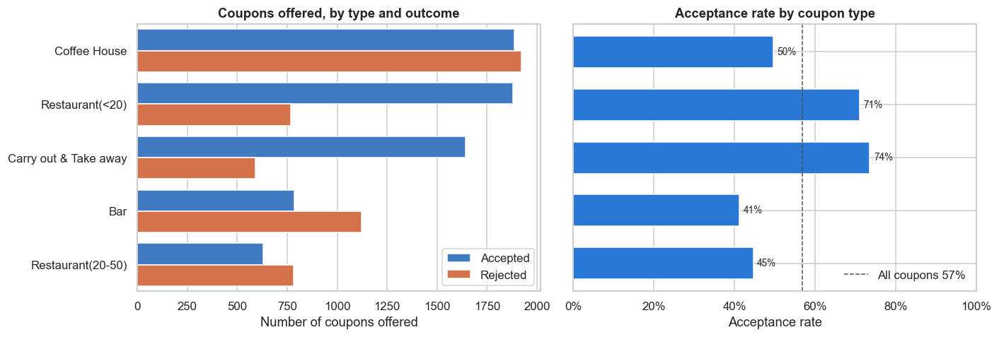
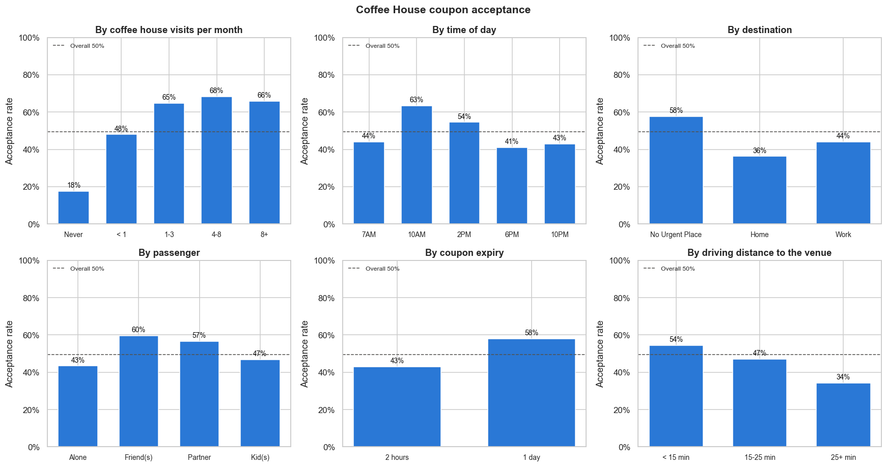
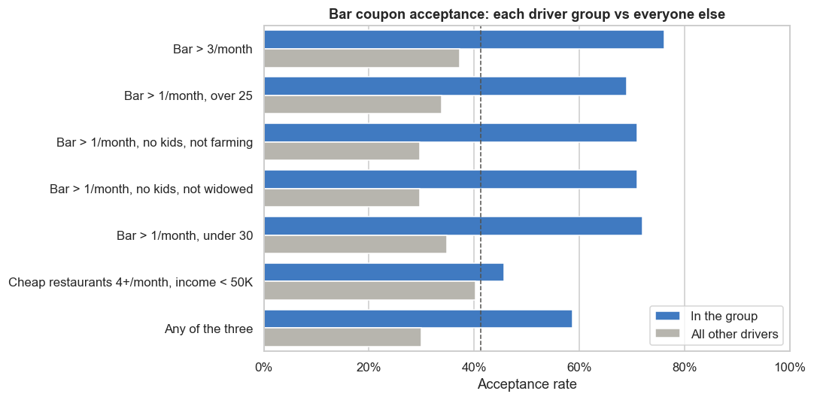

# Will the Customer Accept the Coupon?

Practical Application 1 for the UC Berkeley Professional Certificate in Machine Learning & Artificial Intelligence.

**Full analysis:** [coupon_acceptance.ipynb](coupon_acceptance.ipynb)

## The question

In a survey, drivers were shown a coupon for a place near their route (a coffee house, a bar, a carry-out, a cheap restaurant or an expensive restaurant) in different driving situations, and asked whether they would use it. This project looks at what separates the people who said yes from those who said no.

## The data

12,684 survey answers collected on Amazon Mechanical Turk ([UCI Machine Learning Repository](https://archive.ics.uci.edu/dataset/603/in+vehicle+coupon+recommendation)). After removing an empty column, 74 duplicates and the rows with missing habit answers, 12,007 answers remain. Overall, 57% of coupons were accepted, but the rate depends heavily on the type of coupon:

## Findings

**Problem.** The Coffee House coupon is sent out most often but only accepted 50/50. I looked at what separates the drivers who accept it from those who don't.

- **Habit is the biggest determinant.** Drivers who go to a coffee house at least once a month accept about 66% of the time; for them it is somewhat of a ritual. People who never go accept 18%.
- **The moment matters.** Acceptance hits a high point mid-morning, when people have a dip in energy, and falls from midday. People going nowhere urgent stop by; people driving home in the evening, winding down, don't need a stimulant.
- **Company helps.** Coffee is a social activity: drivers with a friend or partner accept more than drivers alone.
- **Less urgency and short detours help.** A one-day coupon beats a two-hour one, since people get coffee anyway; and people won't go far out of their way for coffee, which has little product differentiation.
- **Who the person is matters little.** Age, income, education, marital status, children and gender barely change acceptance; coffee is an everyman's drink.
- **The ideal customer** is a coffee regular on a relaxed daytime trip: 77% accept, against 42% for everyone else.
- **Bars tell the same story.** Drivers who already go to bars are the most likely to accept a bar coupon; friends in the car help and kids in the car are a deterrent.

## Actionable items

- Send coffee coupons mainly to drivers who already go to coffee houses.
- Send them mid-morning and early afternoon, on trips with no urgent destination, not on the evening drive home.
- Give a one-day expiry rather than two hours.
- Offer cafés close to the driver's route, not 25+ minutes away.
- Send bar coupons to regular bar-goers with friends in the car, never with kids.

## Next steps

- Run a pilot on a respectable cohort size to test these rules in practice.
- The coupons arrive on the phone, which can work very well; we could also try different platforms, such as the car radio.
- Build a way to predict, before a coupon is sent, how likely it is to be a yes.
- Check whether blue-collar or white-collar work makes a difference.

## Repository contents

| Path | What it is |
|---|---|
| `coupon_acceptance.ipynb` | The full analysis: data cleaning, the bar coupon questions and the Coffee House investigation |
| `data/coupons.csv` | The survey data |
| `images/` | Charts used in this README, saved by the notebook |
| `requirements.txt` | Python libraries needed to run the notebook |

To run it: `pip install -r requirements.txt`, then open `coupon_acceptance.ipynb` in Jupyter and run all cells.
